  

  

  
  
  
  
  

---

<h2> About me</h2>

- I build **full-stack web applications and AI-powered tools**, from the database and API to the interface people use.
- Currently building **[Mentora](https://github.com/RaviRanjan2069/mentora)**, an AI learning platform for students and their teachers.
- I care about clean APIs, tests that catch real bugs, and products that feel simple.
- Based in **Noida, India** · Sharda University.

  
  

<h2> Featured project</h2>

<table>
<tr>
<td width="56%" valign="top">

#### [Mentora](https://github.com/RaviRanjan2069/mentora): an AI learning platform

One place for students to learn, practise and track progress, with their teachers.

- **AI tutor:** a full-screen chat that explains step by step
- **Adaptive practice:** 10-question rounds that get easier or harder and bring back missed topics (800 starter questions, 8 subjects)
- **Goals & plans:** week-by-week roadmaps that adapt to results
- **Progress analytics:** line graphs of real results per subject
- **Teachers:** class codes, subject folders, quizzes and per-question analysis
- Accounts with email verification, password reset and a help desk

**Stack:** FastAPI · MongoDB Atlas · plain HTML/CSS/JS · GitHub Actions CI · Render

A demo with synthetic starter content; not evaluated with real learners.

</td>
<td width="44%" valign="top">

</td>
</tr>
</table>

<h2> Tech Stack</h2>

<h4 align="center">Languages</h4>
<table><tr>
<td align="center" width="104"> <b>Java</b></td>
<td align="center" width="104"> <b>Python</b></td>
<td align="center" width="104"> <b>JavaScript</b></td>
</tr></table>

<h4 align="center">Frontend</h4>
<table><tr>
<td align="center" width="104"> <b>HTML</b></td>
<td align="center" width="104"> <b>CSS</b></td>
<td align="center" width="104"> <b>JavaScript</b></td>
</tr></table>

<h4 align="center">Backend & Database</h4>
<table><tr>
<td align="center" width="104"> <b>Spring Boot</b></td>
<td align="center" width="104"> <b>FastAPI</b></td>
<td align="center" width="104"> <b>MongoDB</b></td>
<td align="center" width="104"> <b>MySQL</b></td>
</tr></table>

<h4 align="center">DevOps & Tools</h4>
<table><tr>
<td align="center" width="104"> <b>Git</b></td>
<td align="center" width="104"> <b>GitHub</b></td>
<td align="center" width="104"> <b>GitHub Actions</b></td>
<td align="center" width="104"> <b>Docker</b></td>
<td align="center" width="104"> <b>Maven</b></td>
<td align="center" width="104"> <b>VS Code</b></td>
</tr></table>

<h2> GitHub stats</h2>

  <picture>
    <source media="(prefers-color-scheme: dark)" srcset="https://github-readme-stats.vercel.app/api?username=RaviRanjan2069&show_icons=true&theme=github_dark&border_radius=10&rank_icon=github" />
    
  </picture>
  <picture>
    <source media="(prefers-color-scheme: dark)" srcset="https://github-readme-stats.vercel.app/api/top-langs/?username=RaviRanjan2069&layout=compact&theme=github_dark&border_radius=10&langs_count=6" />
    
  </picture>

  <picture>
    <source media="(prefers-color-scheme: dark)" srcset="https://streak-stats.demolab.com?user=RaviRanjan2069&theme=github-dark-blue&border_radius=10&date_format=j%20M%5B%20Y%5D" />
    
  </picture>

<h2> LeetCode</h2>

  <a href="https://leetcode.com/u/Raviranjan2069/">
    <picture>
      <source media="(prefers-color-scheme: dark)" srcset="https://leetcard.jacoblin.cool/Raviranjan2069?theme=dark&font=Inter&ext=heatmap&border=1&radius=10" />
      
    </picture>
  </a>

<h2> Contribution activity</h2>

  <picture>
    <source media="(prefers-color-scheme: dark)" srcset="https://raw.githubusercontent.com/RaviRanjan2069/RaviRanjan2069/output/activity-graph-dark.svg" />
    
  </picture>

  <picture>
    <source media="(prefers-color-scheme: dark)" srcset="https://raw.githubusercontent.com/RaviRanjan2069/RaviRanjan2069/output/github-snake-dark.svg" />
    
  </picture>

<h2> Let's connect</h2>

  
  
  
  

  

